# Guía de uso

Recorrido completo de WifiHeat sobre `samples/demo.dwg`, desde cargar el plugin hasta exportar el mapa, con la explicación de cada dato de configuración, cómo leer los colores y qué hacer con los problemas más comunes. El modelo y las ecuaciones están en [modelo.md](modelo.md); la lista de comandos, en el [README](../README.md).

## Contenido

1. [Antes de empezar](#antes-de-empezar)
2. [Recorrido sobre el ejemplo](#recorrido-sobre-el-ejemplo)
3. [Configuración del punto de acceso](#configuración-del-punto-de-acceso)
4. [Cómo leer el resultado](#cómo-leer-el-resultado)
5. [Problemas frecuentes](#problemas-frecuentes)

## Antes de empezar

`samples/demo.dwg` es una planta de 30 × 14 m con seis ambientes, en metros. Sus muros ya están dibujados como ejes y con material asignado, y el punto de acceso (AP) ya está colocado en (2; 3) m, en 5 GHz con 20 dBm. No tiene columnas ni muros dibujados con dos caras: esos pasos se practican con los ejercicios marcados como **Ejercicio** sobre una copia del archivo.

Trabajar siempre sobre una copia del dibujo cuando se haga un ejercicio: los pasos de preparación agregan entidades.

## Recorrido sobre el ejemplo

### 1. Cargar el plugin

1. Compilar con `dotnet build WifiHeat.slnx`.
2. En AutoCAD, agregar `src\WifiHeat.AutoCAD.UI\bin\Debug\net10.0-windows` a las ubicaciones de confianza (`TRUSTEDPATHS`). No desactivar `SECURELOAD`.
3. Abrir `samples/demo.dwg`.
4. Ejecutar `NETLOAD` y elegir `WifiHeat.AutoCAD.dll` de esa carpeta; repetir con `WifiHeat.AutoCAD.UI.dll`.

Los comandos (`WIFICALCULATE`, `WIFIQUERY`, etc.) funcionan solo con la primera DLL; la segunda agrega el panel.

### 2. Abrir el panel

Ejecutar `WIFIPANEL`. Se abre una paleta acoplable con siete secciones, de «1 · Preparar plano» a «7 · Exportar PNG». Mientras el panel espera algo en el dibujo, arriba aparece un aviso con el modo («MODO: UBICAR PUNTO DE ACCESO», por ejemplo) y el botón «CANCELAR (ESC)». El resultado de cada acción se ve al pie, con un color por gravedad, y el historial guarda los últimos mensajes.

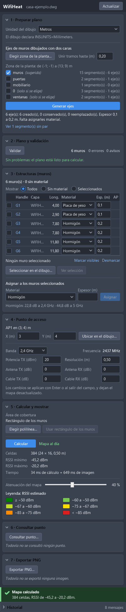

### 3. Elegir la unidad del dibujo

En «1 · Preparar plano», el desplegable «Unidad del dibujo» indica en qué unidad está dibujado el plano: metros, centímetros o milímetros. WifiHeat necesita saberlo para convertir las longitudes a metros y no calcula sin ese dato. El ejemplo ya está en metros.

En un plano propio, no fiarse de la unidad que declara el dibujo: medir un muro conocido con `DIST` y elegir la unidad que da una medida razonable (ver [Escala y unidad](#escala-y-unidad)).

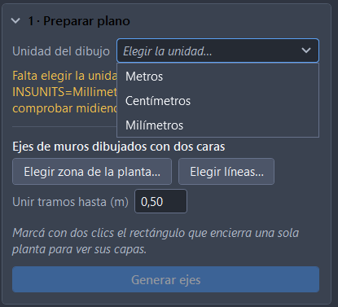

### 4. Elegir la zona de la planta

Este paso solo sirve cuando los muros están dibujados con sus dos caras (dos líneas por muro). Un dibujo puede tener varias plantas, cortes y vistas en el mismo espacio modelo; la zona limita el trabajo a una sola planta.

1. Pulsar «Elegir zona de la planta…».
2. Hacer clic en dos esquinas opuestas de un rectángulo que encierre **una sola planta**.
3. El panel lista las capas que contiene la zona, con la cantidad de segmentos y de ejes que saldrían de cada una. Marcar las capas que contienen las caras de los muros (la capa `0` y `ventanas` se procesan solo si se las marca a propósito).

En `demo.dwg` no hay nada para listar: los muros ya son ejes y las capas `WIFIHEAT_*` no se toman como caras.

**Ejercicio.** En una copia, crear la capa `muros` y dibujar dos líneas paralelas separadas 0,20 m, por ejemplo de (15; 0) a (15; 3) y de (15,2; 0) a (15,2; 3). Elegir una zona que las encierre: el panel muestra la capa `muros` con 2 segmentos y 1 eje.

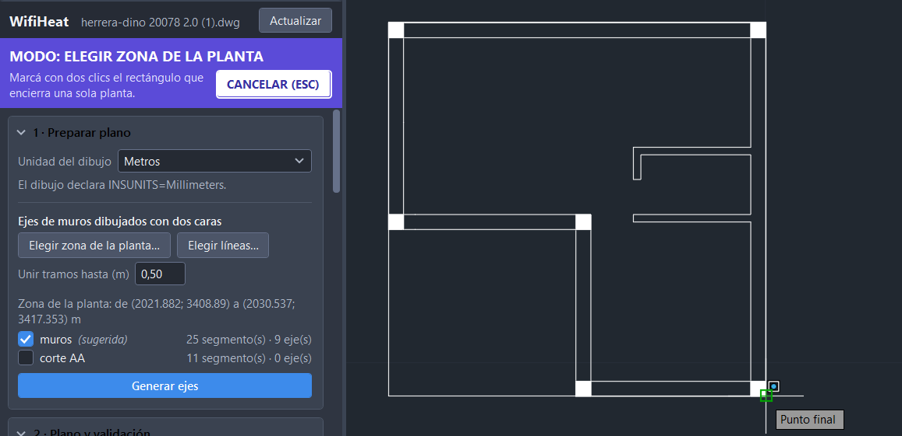

### 5. Generar los ejes

Con las capas marcadas, el campo «Unir tramos hasta (m)» (0,20 m por defecto) cierra las aberturas más angostas que esa distancia entre tramos alineados. Pulsar «Generar ejes»: por cada par de caras paralelas separadas hasta 0,50 m se crea un eje a mitad de distancia, en la capa `WIFIHEAT_MUROS`, con el espesor medido y sin material. Las líneas originales no se modifican y repetir el paso sobre la misma zona no duplica los ejes.

Si las caras de un muro están en capas distintas, o la zona toma líneas de más, usar «Elegir líneas…»: genera ejes solo entre las líneas que se elijan, sin importar su capa.

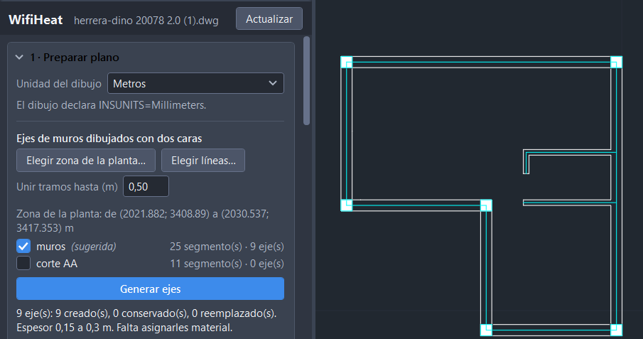

### 6. Validar

En «2 · Plano y validación», pulsar «Validar». El panel cuenta muros, errores y avisos. Con un problema seleccionado, el panel selecciona la entidad en el dibujo y encuadra la vista. En el ejemplo no hay errores ni avisos. En el ejercicio del paso 5, los ejes recién creados aparecen como `FALTA PROPIEDAD`: todavía no tienen material.

Un error impide calcular; un aviso no, pero conviene revisarlo.

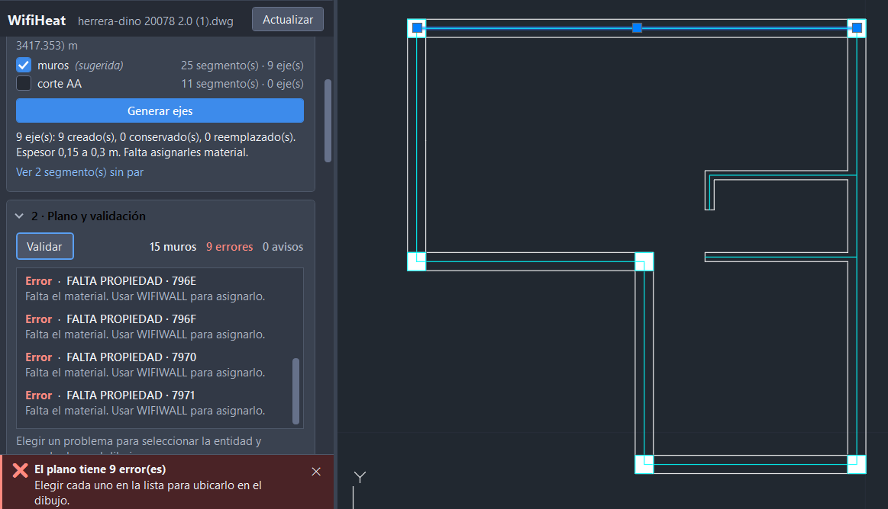

### 7. Asignar materiales

«3 · Estructuras (muros y columnas)» muestra la tabla de muros: handle, capa, longitud, material y espesor. El material y el espesor se editan en la fila. El filtro «Sin material» deja solo los muros que todavía lo necesitan.

Para asignar en bloque: «Seleccionar en el dibujo…», elegir material y espesor y pulsar «Asignar». Las líneas que todavía no eran muros pasan a `WIFIHEAT_MUROS`. Un espesor vacío conserva el de cada muro (0,15 m si no tiene).

| Material | Pérdida a 2,4 GHz | Pérdida a 5 GHz |
| --- | --- | --- |
| Hormigón | 22,8 dB | 44,8 dB |
| Ladrillo macizo | 9,0 dB | 17,5 dB |
| Ladrillo hueco | 6,0 dB | 10,0 dB |
| Placa de yeso | 5,4 dB | 10,1 dB |
| Vidrio común | 3,0 dB | 3,5 dB |

El espesor se guarda pero no cambia la pérdida: cada muro cruzado resta el valor completo de su material. Las fuentes están en [config/materials.json](../config/materials.json).

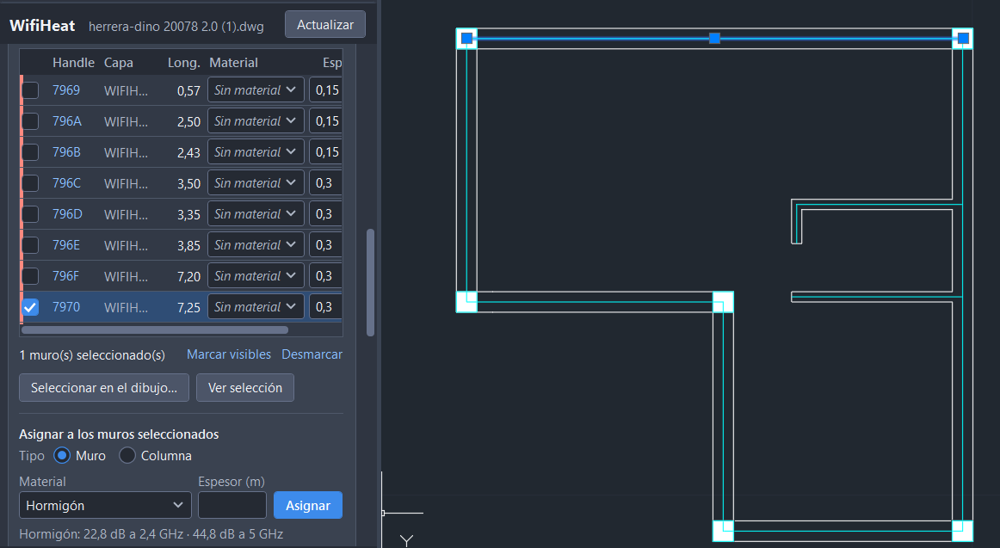

### 8. Marcar las columnas con armadura

Las columnas de hormigón armado tienen un adicional de pérdida según su armadura. Se marcan en la misma sección 3:

1. En «Tipo», elegir **Columna**. El material queda en hormigón.
2. En «Armadura», elegir baja, media o alta. El panel muestra un ejemplo de cada una y la pérdida total que resulta en cada banda.
3. Pulsar «Seleccionar en el dibujo…» y elegir los hatches o las polilíneas cerradas de las columnas.
4. Pulsar «Asignar».

| Armadura | Ejemplo en una columna de 30 × 30 cm | Adicional |
| --- | --- | --- |
| Baja | 4 barras Ø20 | 2,5 dB |
| Media | 8 barras Ø20 | 5 dB |
| Alta | 12 barras Ø20 | 7,5 dB |

La columna es una polilínea cerrada nueva en `WIFIHEAT_MUROS`; el hatch y el contorno originales no se tocan. Si de una misma columna se eligen el hatch y su contorno, se crea una sola. Los adicionales son una convención del proyecto, no una medición (ver [modelo.md](modelo.md#columnas-de-hormigón-armado)).

**Ejercicio.** En una copia del ejemplo, crear la capa `columnas`, dibujar un rectángulo con `RECTANG` de (6; 4) a (6,3; 4,3) y agregarle un hatch sólido. Elegir ambos, con armadura alta. La fila de la tabla dice «Columna · armadura alta».

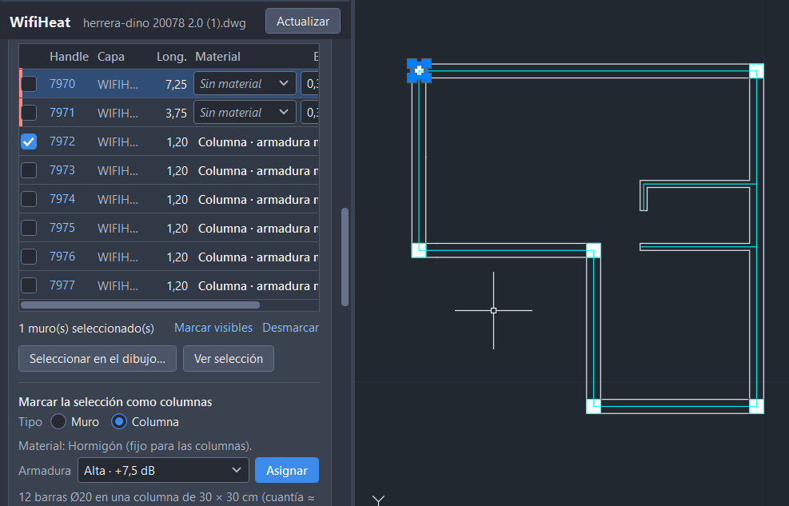

### 9. Ubicar el punto de acceso

En «4 · Punto de acceso», «Ubicar en el dibujo…» pide un clic en el plano; también se pueden escribir X e Y en metros. El ejemplo ya tiene el AP en (2; 3) m. Si el punto de acceso queda dentro de una columna, no se calcula y se avisa.

Banda, potencia, ganancias, cables y resolución se explican en la [siguiente sección](#configuración-del-punto-de-acceso). Cada cambio deja el mapa marcado como desactualizado hasta calcular de nuevo.

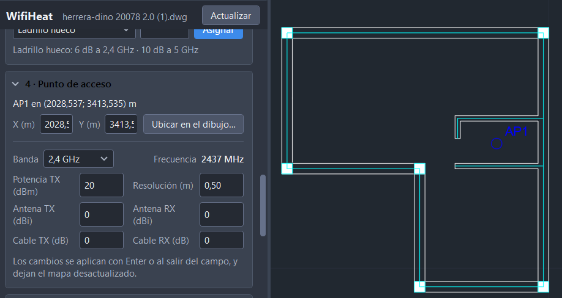

### 10. Calcular

En «5 · Calcular y mostrar»:

1. El área de cobertura por defecto es el rectángulo que encierra los muros. Con «Elegir polilínea…» se la reemplaza por una polilínea cerrada de tramos rectos; «Usar rectángulo de los muros» vuelve al valor por defecto. Fuera del área no se calcula ni se pinta.
2. Pulsar «Calcular». El resumen informa las celdas (1680 en el ejemplo, de 0,50 m), el RSSI mínimo y máximo y el tiempo.
3. El mapa se inserta como imagen en la capa `WIFIHEAT_OVERLAY`, debajo del plano, con su leyenda en `WIFIHEAT_LEYENDA`. El control «Atenuación del mapa» (0 a 90 %) aclara los colores sin recalcular.

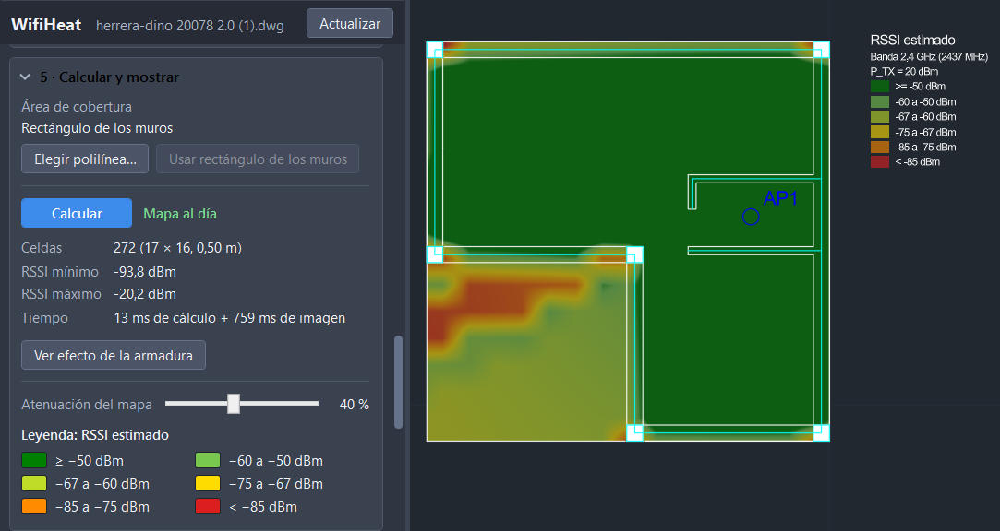

### Elegir el modelo de propagación

En «5 · Calcular y mostrar», la lista «Modelo de propagación» tiene tres opciones:

| Modelo | Cuándo usarlo |
| --- | --- |
| Línea recta (por defecto) | Cálculo inmediato. Cada muro o columna que cruza la recta entre el AP y el punto resta su pérdida completa, así que las sombras son abruptas. |
| Con difracción | Cuando hay columnas, aberturas o muros con extremos libres. Suma la señal que rodea esos obstáculos: la sombra detrás de una columna se aclara y se difumina. Tarda más. |
| Con difracción y reflexiones | Para ver además la señal que llega rebotando en las paredes, por ejemplo en pasillos o detrás de una esquina. Suma un rebote por muro o cara de columna. Es el más lento. |

Al cambiar la opción, el mapa queda marcado como desactualizado y hay que pulsar «Calcular» otra vez. El resumen del cálculo y la leyenda dicen con qué modelo se hizo el mapa. Con comandos, es la opción `Modelo` de `WIFICALCULATE`: `Recta`, `Difracción` o `Reflexiones`; las dos últimas piden además las difracciones máximas por trayecto (Enter deja 3).

El ejemplo `samples/demo.dwg` no tiene aberturas ni extremos libres de muro: sin la columna del paso 8, la línea recta y la difracción dan el mismo mapa (el modelo con reflexiones sí cambia, porque suma los rebotes en las paredes). Con una columna de 30 × 30 cm de armadura media en (6; 4), el punto (9,47; 5,07), que queda detrás, pasa de −94,32 dBm con línea recta a −54,03 dBm con difracción.

### 11. Consultar puntos

En «6 · Consultar punto», pulsar «Consultar punto…» y hacer clic en el plano. La tarjeta muestra el punto, la distancia al AP, $L_0$, la pérdida de los materiales y $P_{RX}$, y «Explicación completa» detalla cada muro cruzado. Cada clic actualiza la tarjeta; Esc o Enter terminan. Los muros que cruza el trayecto se marcan en la tabla de la sección 3. Con el modelo «Con difracción y reflexiones», la tarjeta suma «Muros donde rebota»: cada muro o columna donde rebota la señal, con su material, el punto de rebote, el ángulo y la pérdida del rebote; «Ver en el dibujo» los resalta.

En el ejemplo, con 20 dBm en 5 GHz y sin ganancias ni cables:

| Punto | Distancia | $L_0$ | Muros cruzados | $P_{RX}$ |
| --- | --- | --- | --- | --- |
| (8; 5) m | 6,32 m | 62,76 dB | ninguno | −42,76 dBm |
| (26; 11) m | 25,30 m | 74,80 dB | ladrillo macizo (17,5), placa de yeso (10,1) y ladrillo hueco (10,0): 37,6 dB | −92,40 dBm |

Con la columna del ejercicio del paso 8 (armadura alta), el punto (9,47; 5,07) m queda en su sombra: −44,52 dBm sin la columna y −96,82 dBm con ella (44,8 dB de hormigón y 7,5 dB de armadura).

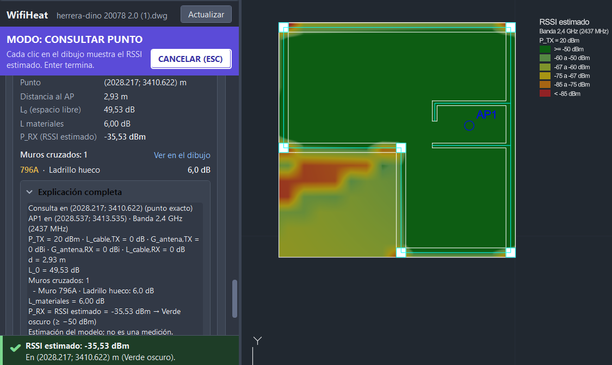

### 12. Ver el efecto de la armadura

Con columnas con armadura marcadas y el mapa calculado, «Ver efecto de la armadura» reemplaza el mapa por la pérdida que agrega la armadura: la diferencia en dB entre el cálculo normal y el mismo cálculo con las columnas como hormigón sin armadura. Solo se pintan los puntos cuyo trayecto cruza una columna (una cuña detrás de cada una); el resto queda transparente. Con una columna de armadura alta, el color más oscuro vale 7,5 dB.

**No es un nivel de señal:** tiene su propia leyenda, «Pérdida que agrega la armadura (dB)». Para este mapa se usa una celda de 0,20 m como máximo, y si la resolución elegida era mayor, el mensaje lo avisa. Sin columnas con armadura, el panel avisa que no hay nada que mostrar y el mapa no cambia. «Calcular» vuelve al mapa de cobertura.

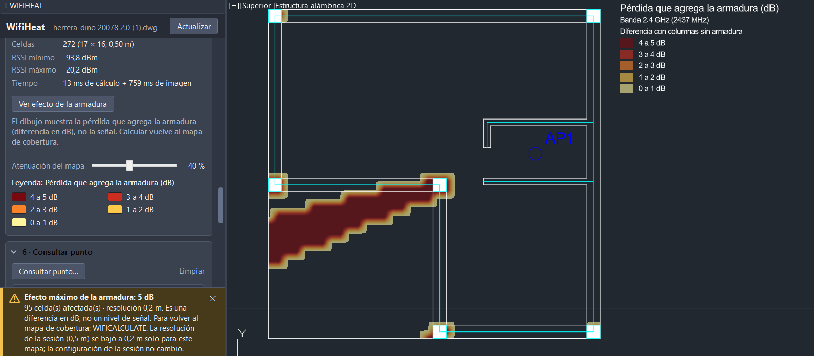

### 13. Exportar

«7 · Exportar PNG» guarda la imagen del último cálculo con los muros, el punto de acceso y la leyenda, y muestra la ruta del archivo. El comando equivalente es `WIFIEXPORT`. El archivo propuesto es `<dibujo>-wifiheat.png`, junto al dibujo (o `wifiheat.png` en Documentos si el dibujo no está guardado).

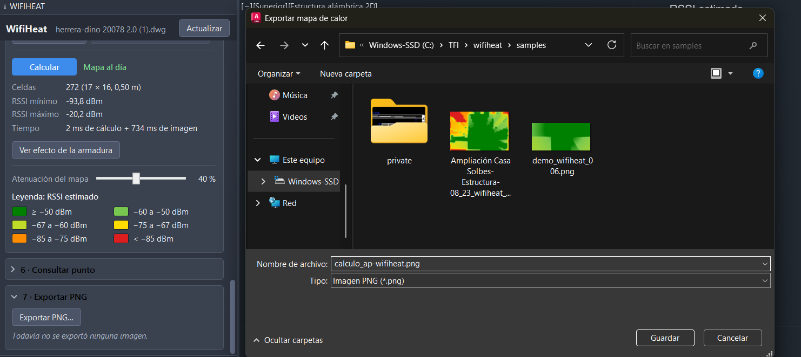

## Configuración del punto de acceso

Los datos de «4 · Punto de acceso» alimentan el balance de enlace:

$$P_{RX} = P_{TX} - L_{cable,TX} + G_{antena,TX} - L_0 - L_{materiales} + G_{antena,RX} - L_{cable,RX}$$

$$L_0 = 32{,}45 + 20\log_{10} f\,[\mathrm{MHz}] + 20\log_{10} d\,[\mathrm{km}]$$

Todo se suma y se resta en decibeles, desde el transmisor hasta el receptor. Los valores que no se conocen se dejan en 0 dB o 0 dBi.

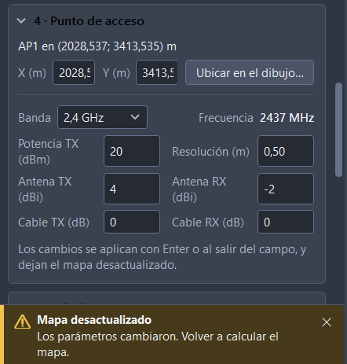

| Campo | Qué es | Valores típicos de un AP de interior |
| --- | --- | --- |
| Banda | Frecuencia de trabajo. El modelo usa 2437 MHz para 2,4 GHz y 5180 MHz para 5 GHz. En 5 GHz la pérdida en el espacio libre es 6,5 dB mayor y los materiales atenúan más (ver la tabla del paso 7). | 2,4 GHz o 5 GHz |
| Potencia TX (dBm) | Potencia que entrega el transmisor, $P_{TX}$. | 18 a 23 dBm (20 por defecto) |
| Antena TX (dBi) | Ganancia de la antena del AP, $G_{antena,TX}$. Se aplica igual en todas las direcciones: el modelo no tiene diagrama de radiación. | 3 a 6 dBi |
| Cable TX (dB) | Pérdida entre el transmisor y la antena, $L_{cable,TX}$. Si la antena es integrada no hay cable. Con una antena externa, usar la pérdida del cable y los conectores. | 0 dB con antena integrada |
| Antena RX (dBi) | Ganancia de la antena del dispositivo que recibe, $G_{antena,RX}$. | −3 a 0 dBi (celulares y notebooks) |
| Cable RX (dB) | Pérdida entre la antena del receptor y su entrada, $L_{cable,RX}$. | 0 dB |
| Resolución (m) | Tamaño de la celda de la grilla, de 0,10 a 5 m (0,50 por defecto). | ver abajo |

La potencia más la ganancia de antena menos la pérdida del cable es lo que el AP efectivamente irradia. Ejemplo en 5 GHz a 10 m, sin muros, con 20 dBm, antena de 4 dBi, sin cable y un receptor de −2 dBi: $L_0$ = 66,74 dB y $P_{RX}$ = 20 + 4 − 66,74 − 2 = −44,74 dBm.

**Resolución.** Para cada celda de la grilla se calcula un valor en su centro y el mapa se interpola entre ellas. Una celda más chica muestra mejor las sombras angostas (como la de una columna de 30 cm, que necesita 0,20 m o menos) pero genera más celdas y tarda más. Con 0,50 m un plano de 30 × 14 m tiene 1680 celdas. Si la grilla supera los 2 000 000 de celdas, el cálculo se rechaza con el error `ÁREA GRANDE`: aumentar la resolución o acotar el área de cobertura.

La ganancia, el cable y la resolución se conservan mientras el dibujo esté abierto; en el dibujo se guardan la banda y la potencia del AP.

## Cómo leer el resultado

El color de cada punto es la potencia recibida estimada, $P_{RX}$, en dBm: cuanto más cerca de 0, más fuerte. Los rangos son una referencia general, no una garantía de conexión ni de calidad de servicio.

| $P_{RX}$ | Color | Qué significa |
| --- | --- | --- |
| ≥ −50 dBm | Verde oscuro | Señal muy fuerte, típica de la cercanía del AP. |
| −60 a −50 dBm | Verde claro | Muy buena: velocidades altas y estables. |
| −67 a −60 dBm | Amarillo verdoso | Buena. Es el nivel mínimo que suele tomarse como referencia para voz y video. |
| −75 a −67 dBm | Amarillo | Aceptable para navegar y descargar; las llamadas y el video pueden cortarse. |
| −85 a −75 dBm | Naranja | Débil: velocidad baja e inestable, con desconexiones. |
| < −85 dBm | Rojo | Muy débil: en la práctica sin conexión útil. |

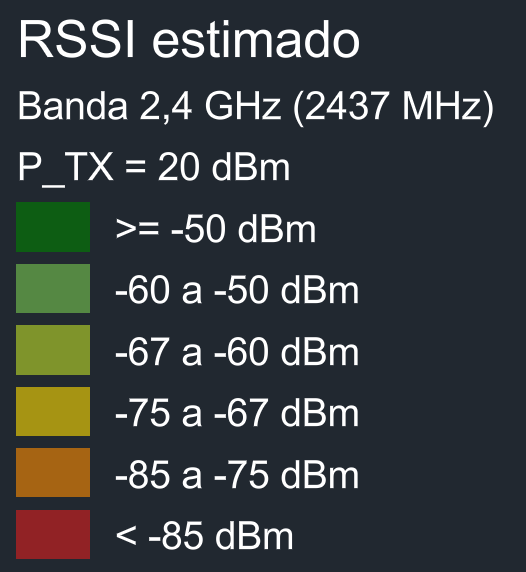

El mapa es un degradé continuo: el color puro aparece en el centro de cada rango y en los límites se ve la mezcla de los dos vecinos. Cada rango incluye su límite inferior.

Qué mirar en el mapa:

- **Sombras detrás de muros.** Cada muro cruzado por el trayecto directo resta su pérdida completa; las sombras se ven como saltos de color al otro lado.
- **Distancia.** Aun sin muros el color baja con la distancia: la pérdida en el espacio libre crece 6 dB cada vez que la distancia se duplica.
- **Bordes difuminados.** Cerca de los muros hay una banda de unos 0,5 m donde se mezclan los dos lados, y los bordes diagonales de las sombras se ven escalonados según la resolución.
- **Qué no incluye.** El modelo de línea recta usa solo el trayecto directo: no calcula reflexiones ni difracción, así que una sombra real suele ser menos profunda que la del mapa. El modelo con difracción agrega la señal que rodea los obstáculos, y el de reflexiones, un rebote en cada muro; ninguno calcula rebotes en techo y piso ni varios rebotes sucesivos (ver [limitaciones](modelo.md#limitaciones)).

La escala de dBm es independiente de la del efecto de la armadura, que va de amarillo claro a rojo oscuro pero mide dB de pérdida agregada: no confundir los dos mapas, cada uno tiene su leyenda.

## Problemas frecuentes

### Doble conteo

**Qué se ve.** Una consulta que cruza «dos muros» donde el plano tiene uno, y zonas detrás de ese muro con menos señal que la esperada. En `WIFIVALIDATE` aparece el aviso `DOBLE CONTEO` con los handles de los dos muros.

**Por qué.** Muchos planos dibujan el espesor de un muro con dos líneas, las dos caras. WifiHeat toma cada línea como un muro, así que la pérdida se suma dos veces (dos muros de 9 dB dan 18 dB en lugar de 9 dB).

**Cómo se arregla.**

- Antes de asignar, usar «Generar ejes» (pasos 4 y 5) o dejar que la asignación una las caras: cuando la selección trae las dos caras de un muro, el panel ofrece «Unir en ejes» (en `WIFIWALL`, la pregunta `Unir caras`).
- Si el aviso aparece al validar, pulsar «Convertir en ejes»: crea un eje con el material de las caras y pasa las caras a la capa `WIFIHEAT_CARAS`, que no se lee como muro.
- Un grupo en el que un muro tiene además un tramo sin par de más de 0,5 m no se convierte, para no dejar un hueco: se informa con los handles para corregirlo a mano.

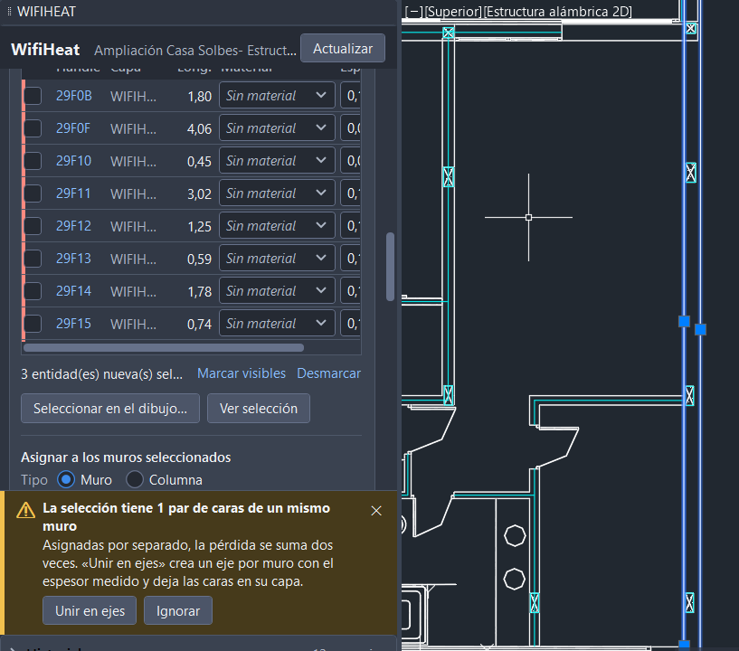

### Una polilínea es un solo muro

Cada línea o polilínea cuenta como un obstáculo, una sola vez por trayecto, aunque el trayecto cruce varios de sus tramos. Un ambiente completo dibujado como una polilínea cerrada cuenta una vez, no dos. Para que los muros se cuenten por separado hay que dibujarlos como entidades distintas. Las polilíneas con arcos dan error de geometría y ese muro se omite.

### Capas

- Solo la capa `WIFIHEAT_MUROS` se lee como muros. Asignar un material (o generar ejes) mueve o crea las entidades ahí.
- «Generar ejes» sugiere la capa `muros` si existe. Las capas `0` y `ventanas` suelen tener mobiliario y vidrios: se procesan solo si se las marca a propósito.
- Si las dos caras de un muro están en capas distintas, o la zona toma líneas de más, usar «Elegir líneas…».
- Si los ejes se generaron con una capa equivocada, borrarlos (están en `WIFIHEAT_MUROS`) y repetir con las capas correctas.

### Escala y unidad

Si el plano está en una unidad distinta de la que declara, las distancias salen mal por un factor de 10, 100 o 1000. Dos señales:

- El aviso `ESCALA SOSPECHOSA`: la envolvente de los muros mide menos de 2 m o más de 500 m.
- El error `UNIDADES`: falta elegir la unidad y no se calcula.

Para resolverlo: medir un muro conocido con `DIST`, elegir en el panel (o con `WIFISETUP`) la unidad en la que esa medida es razonable y validar de nuevo. Un dibujo en milímetros elegido como metros hace que el plano parezca de 12 000 m de lado.

Si en el mismo espacio modelo hay varias plantas, cortes y vistas, marcar la zona de una sola planta antes de generar ejes y acotar el área de cobertura.

### Columnas dibujadas como hatch

Las columnas de los planos suelen ser un hatch sobre un contorno cerrado, en capas distintas. WifiHeat las lee de las dos formas:

- Hatch y contorno de la misma columna dan **una** columna, no dos (se comparan con una tolerancia de 2 cm).
- Un hatch que sombrea varias columnas separadas da una columna por contorno.
- Un hatch con islas (un contorno dentro de otro) o con arcos no se acepta: el panel informa el handle con un error `GEOMETRÍA INVÁLIDA`.
- Repetir la asignación no duplica las columnas: conserva las existentes y actualiza su armadura.

Elegir el tipo Columna antes de seleccionar: con el tipo Muro, los hatches no se aceptan.

### Columnas dibujadas con líneas sueltas

Una columna hecha con cuatro líneas independientes no se reconoce como figura cerrada. Además, «Generar ejes» puede tomar dos lados opuestos como las caras de un muro y crear un eje falso, que aparece en la validación como `FALTA PROPIEDAD`.

Arreglo: borrar el eje falso y reemplazar las cuatro líneas por un contorno cerrado, con `RECTANG` o uniéndolas con `PEDIT` (opciones Unir y Cerrar). Después marcarla como columna.

### Figuras cerradas que no son columnas

«Generar ejes» no toma como caras las polilíneas cerradas de hasta 1,5 m de lado, ni los hatches, porque pueden ser columnas. Si hay figuras de ese tamaño en la zona, el panel lo avisa («figuras cerradas pequeñas») y ofrece «Marcar como columnas» y «Ver en el dibujo». Pero en una planta también hay mesas, artefactos, símbolos y otras figuras de ese tamaño:

- Usar «Ver en el dibujo» para revisar cuáles son antes de decidir.
- «Marcar como columnas» crea una columna por **cada** figura detectada. Si hay figuras que no son columnas, es mejor no usar el botón y elegir una por una con el tipo Columna y «Seleccionar en el dibujo…».
- Una figura de más de 1,5 m de lado no se convierte: el mensaje dice «No parece una columna».
- Una columna marcada por error se borra como cualquier otra entidad (está en `WIFIHEAT_MUROS`).

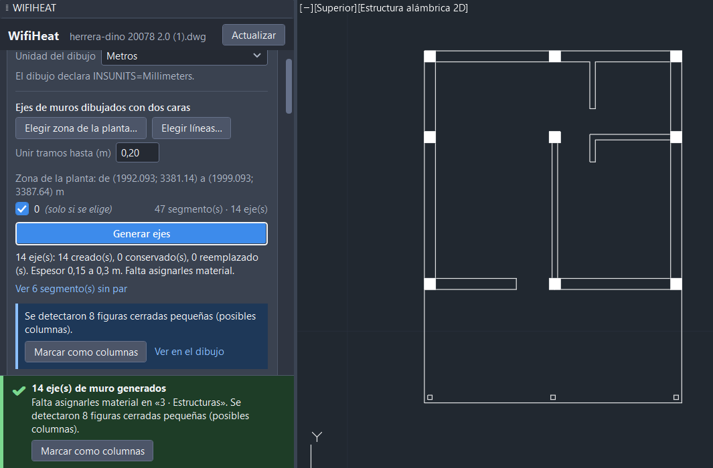

### Ventanas y puertas

No hay un tipo propio. Los ventanales se dibujan como un muro con material «Vidrio común»; un ventiluz lleva el material predominante del muro. Una puerta es un hueco sin pérdida: dejar el muro cortado donde está la puerta. Si el muro se dibuja continuo y encima se dibuja el vidrio, en ese punto solo cuenta la pérdida mayor.

### Otros avisos

- **Mapa desactualizado.** Cambiar muros, el AP o cualquier dato lo marca así: pulsar «Calcular».
- **Sin calcular al reabrir.** La grilla no se guarda en el dibujo: al abrir un dibujo ya calculado hay que calcular otra vez, aunque el mapa viejo siga dibujado.
- **El punto o el AP están dentro de una columna.** No se calcula ni se consulta; mover el punto fuera de la columna.
- **Comando a medias.** Si AutoCAD está ejecutando otro comando, el panel lo avisa y no modifica el dibujo hasta que termine.
